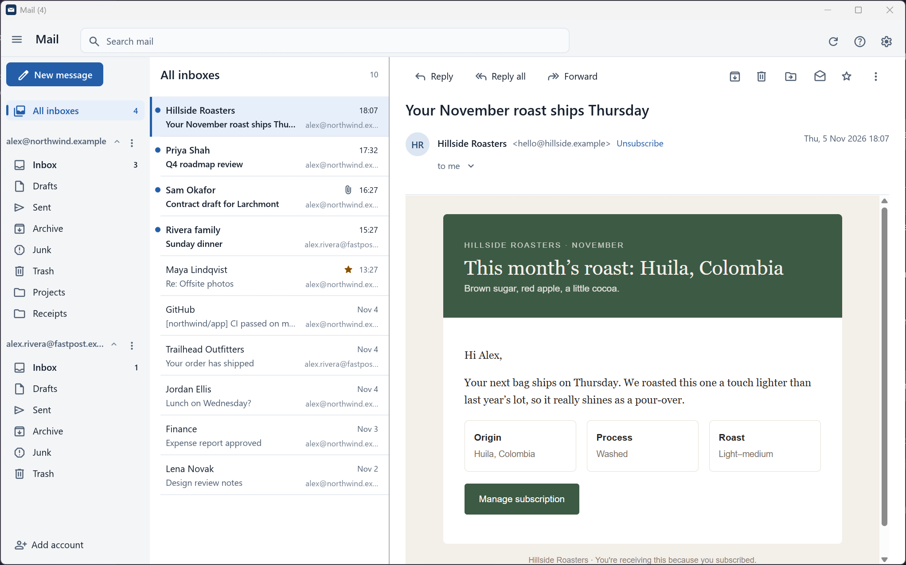
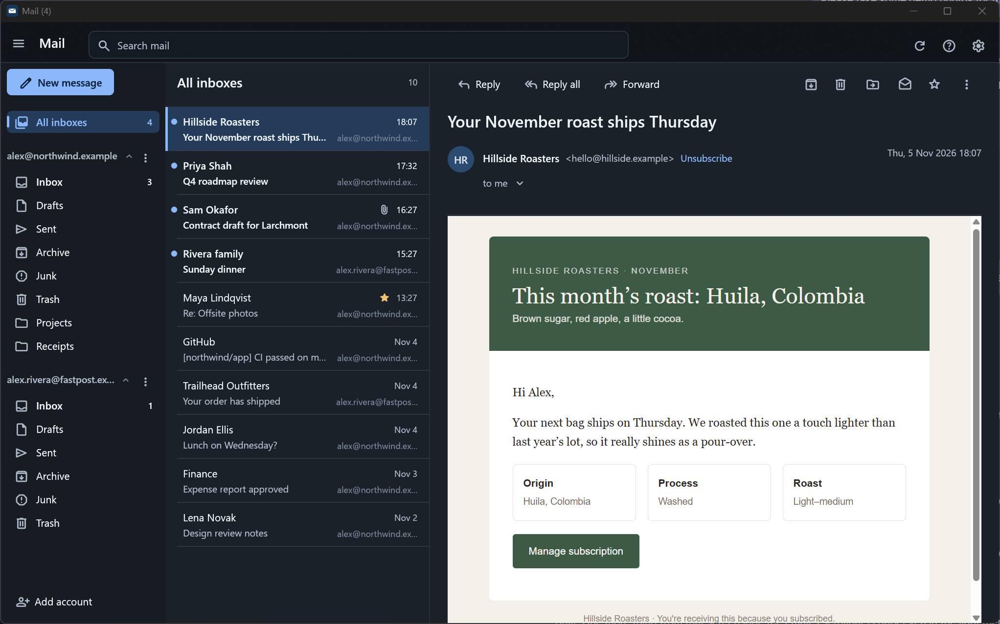
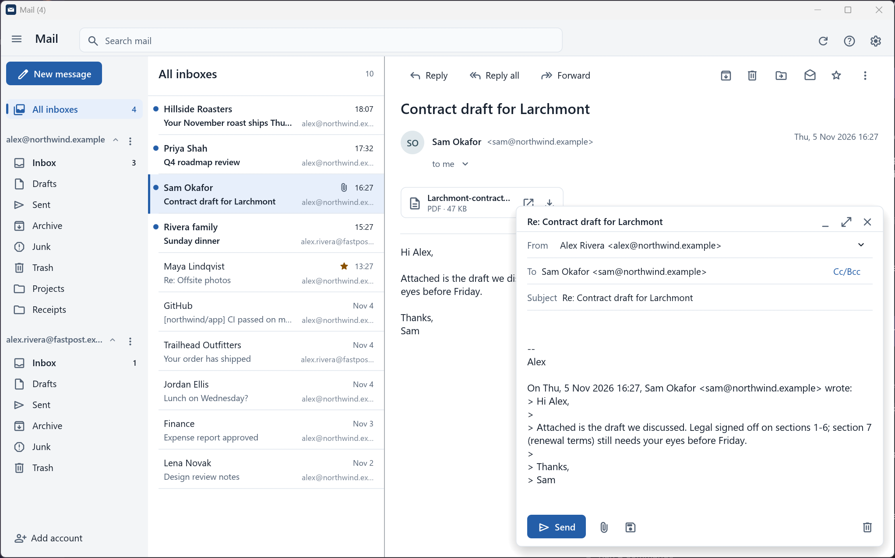
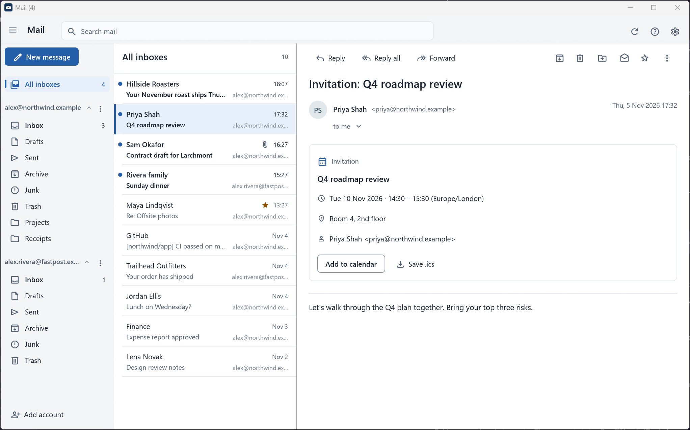
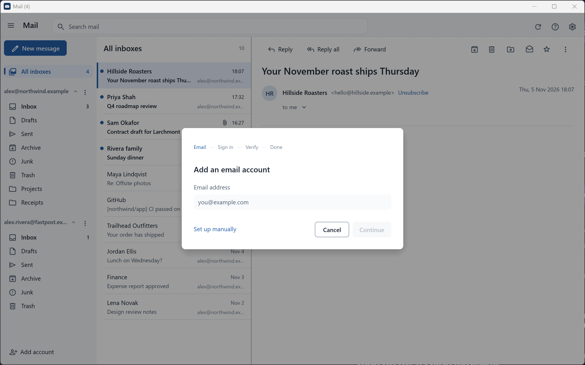
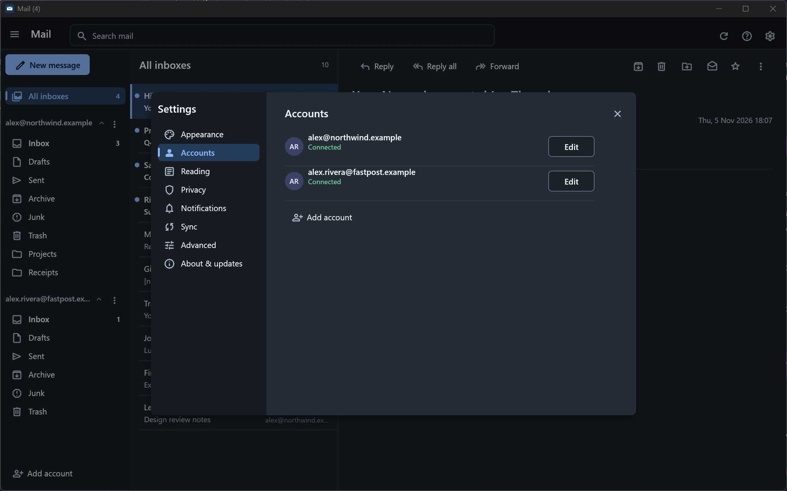

# Mail

[](https://github.com/MattGodwin/mail-rs/actions/workflows/ci.yml)
[](https://github.com/MattGodwin/mail-rs/releases)

A fast, minimal desktop email client written in Rust. It works with any IMAP/SMTP provider
(Gmail, Outlook/Hotmail/Microsoft 365, iCloud, Yahoo, Fastmail and others), keeps all your
accounts signed in side by side, and **never modifies your messages**.



## Install

**[Download the latest release](https://github.com/MattGodwin/mail-rs/releases/latest):**

| Platform | Download |
|---|---|
| Windows | `mail-rs-setup-windows-x64.exe`: the installer (recommended; no admin rights needed) or `mail-rs-windows-x64.exe`: a portable single file |
| macOS | `mail-rs-macos-arm64` (Apple Silicon) or `mail-rs-macos-x64` (Intel) |
| Linux | `mail-rs-linux-x64` |

**Mail keeps itself up to date.** It checks GitHub Releases shortly after it starts and
then once a day, downloads the new version in the background, and verifies it against the
release's SHA-256 checksums.
- **Installed (Windows installer):** the update installs silently when you close Mail, or
  straight away with *Restart now*.
- **Portable copies:** the executable is replaced in place and the new version runs the next
  time you open Mail.

Turn this off, or check manually, in **Settings → About & updates**.

- Single native binary of about 9 MB. The window opens in about a third of a second.
- **A calm, familiar layout:** an Outlook-style folder pane, a message list with hover actions
  (archive, delete, read, star) and multi-select, a reading pane, and Gmail-style compose windows
  docked at the bottom right. Light and dark themes follow your system, and the icons are
  Material Symbols throughout.
- **Push mail:** new messages arrive within seconds over IMAP IDLE, with polling as a fallback.
  Desktop notifications appear even while the window is minimised.
- **Multiple accounts at once:** a unified inbox, every folder of every account, live status
  for each account (synced, offline, sign-in problem), pause/resume, sending aliases and a
  default sending account.
- **Essentials:** read, reply, reply-all, forward, compose and attach files (button or
  drag-and-drop). Archive, delete, move, star and mark read/unread, with **Undo**.
- **You never lose a draft.** Compose windows are saved on this computer as you type and come
  back after a restart or crash. Server drafts keep Bcc and replace earlier versions, and
  quitting waits for anything still being sent.
- **HTML email renders properly.** It uses the system web engine (WebView2 on Windows,
  WebKit on macOS), locked down so scripts never run. Remote images load automatically;
  turn off **Load remote images, styles and fonts** in **Settings → Privacy** to require
  permission per message. Links open in your browser. Popups and compose windows overlay the
  email without moving it.
- **Common email types are handled:**
  - calendar invitations (with *Add to calendar*);
  - inline and attached images (with previews);
  - forwarded emails attached as files, which open in the reader;
  - `format=flowed` text;
  - List-Unsubscribe headers (an *Unsubscribe* button);
  - Chinese, Japanese, Korean, Thai and Indic text.
- **Formats Mail can't fully open are explained instead of shown as confusing attachments:**
  S/MIME and PGP signed or encrypted mail, and Outlook's `winmail.dat`.
- Instant local filter, plus server-side search (press Enter in the filter box).
- Save or open attachments (executables are save-only), or save the original `.eml`.
- Keyboard driven (press `?` in the app).

## Screenshots

| | |
|---|---|
|  |  |
| Dark theme follows your system | Compose docks at the bottom right; the email underneath never moves |
|  |  |
| Calendar invitations become a card with *Add to calendar* | Adding an account: email, sign in, verify, done |



## Leaving your email alone

- **Messages are cached byte for byte.** They're fetched with `BODY.PEEK[]` and stored as
  `.eml` files; the client never re-encodes, re-wraps or "fixes" stored mail. *Save as .eml*
  and *View source* show exactly what the server sent.
- **Opening a message is the only thing that marks it read.** Downloading or prefetching never
  changes read state on the server, and you can turn off mark-on-open in Settings.
- **Remote images load automatically by default.** HTML mail is rendered from a display copy
  served from memory. Scripts, forms and frames stay blocked. To block remote images,
  styles and fonts until you click *Load remote content* for a message, turn off
  **Load remote images, styles and fonts** in **Settings → Privacy**. Remote content can tell senders when
  you open their messages. The stored message is never altered.
- **Outgoing mail is sent exactly as typed.** It's plain text; attachments and forwarded
  attachments go out unchanged.
- **Deletes and moves only touch the messages you chose.** If a server can't remove just those
  messages, Mail marks them deleted rather than expunging anything else.
- **Changes that might have half-happened are never repeated blindly.** If a save or copy is
  interrupted, Mail re-checks the server instead of creating duplicates.
- **Credentials stay in the OS keychain** (Windows Credential Manager, macOS Keychain, Linux
  keyring), never in the config file.
- **Connections are always encrypted:** implicit TLS or mandatory STARTTLS, with no plaintext
  fallback.

## Why it's fast

- **Background connections per account.** Each account has its own IMAP thread plus a push
  (IDLE) connection on the inbox, so the UI never waits on the network.
- **Prioritised commands.** Opening a message jumps ahead of syncing and prefetching.
- **Incremental sync.** After the first sync, each check fetches new UIDs and flag changes
  only (`UIDVALIDITY` is honoured), and unchanged folders cause no disk writes or redraws.
- **Instant startup.** Cached state shows immediately, then syncs in the background. Account
  start-up is staggered so many accounts don't all connect at once.
- **Prefetch and cache.** The newest small messages are downloaded in advance and open
  instantly. Everything is cached on disk after the first open.
- **Virtualised message list.** Only visible rows are laid out, so 10 or 10,000 messages
  scroll the same. The UI is immediate-mode ([egui](https://github.com/emilk/egui)) and
  repaints only when something changes.

## Adding accounts

Click **Add account** (at the bottom of the folder pane) and follow four steps:

1. **Email:** enter your address. Mail finds the server settings for you: from its list of
   known providers, Mozilla's settings database, your domain's own autoconfig file, or the
   domain's mail hosting (so Google Workspace and Microsoft 365 domains are recognised). Only
   the domain is looked up, never your address.
2. **Sign in:** with your browser (OAuth) or an app password, with step-by-step instructions
   and links for your provider.
3. **Verify:** Mail signs in to incoming and outgoing mail and sends nothing.
4. **Done:** open your inbox, or add another account.

*Set up manually* (on the first step) lets you enter any IMAP/SMTP server by hand. Edit an
account later in **Settings → Accounts**; Mail asks before discarding unsaved changes.

| Provider | Sign-in |
|---|---|
| Gmail | An **app password** (requires 2-Step Verification) is the default. OAuth works with your own client ID. |
| iCloud, Yahoo, Fastmail, most others | An **app password** from your provider's security settings. |
| Outlook.com / Hotmail / Microsoft 365 | **OAuth only.** Microsoft no longer accepts passwords over IMAP/SMTP. |

### OAuth client IDs (Microsoft, and optionally Google)

OAuth sign-in needs a client ID registered to *you*. It's free and only needs doing once. The
account dialog walks you through it and checks the ID's format before opening the browser.
Saving it in **Settings** pre-fills it for new accounts.

**Microsoft (Outlook.com, Hotmail, Microsoft 365)**
1. Go to <https://entra.microsoft.com> → *App registrations* → *New registration*.
2. Supported account types: *Accounts in any organizational directory and personal Microsoft accounts*.
3. Redirect URI: platform **Public client/native (mobile & desktop)**, value `http://localhost`.
4. *API permissions* → add the delegated permissions `IMAP.AccessAsUser.All`, `SMTP.Send`
   and `offline_access`.
5. Copy the *Application (client) ID* into Mail. No secret is needed.

**Google (Gmail / Workspace)**
1. Go to <https://console.cloud.google.com> → create a project → enable the **Gmail API**.
2. *OAuth consent screen*: External, add the scope `https://mail.google.com/`, and add
   yourself as a test user.
3. *Credentials* → *Create credentials* → *OAuth client ID* → **Desktop app**.
4. Copy the client ID and secret into Mail.

### IT admin setup (Microsoft 365 work and school accounts)

Some organisations block new apps or turn off IMAP/SMTP. Mail recognises these errors, explains
them, and gives you a link or command to copy. This section is meant to be forwarded to your IT
admin.

**"Need admin approval"** (`AADSTS65001`, `AADSTS90094`, `AADSTS90095`): the tenant requires an
admin to approve the app. A Global Administrator, Application Administrator or Cloud Application
Administrator opens this link, signs in and accepts. Replace `YOUR_CLIENT_ID` with the client ID
the user entered in Mail (Mail fills it in for you when it shows the error):

```
https://login.microsoftonline.com/organizations/v2.0/adminconsent?client_id=YOUR_CLIENT_ID&scope=https%3A%2F%2Foutlook.office.com%2FIMAP.AccessAsUser.All+https%3A%2F%2Foutlook.office.com%2FSMTP.Send+offline_access&redirect_uri=http%3A%2F%2Flocalhost
```

Mail asks only for `IMAP.AccessAsUser.All`, `SMTP.Send` and `offline_access`.

**Sending fails with `5.7.139`** (SMTP AUTH is disabled): enable it for the user's mailbox in
[Exchange Online PowerShell](https://learn.microsoft.com/powershell/exchange/connect-to-exchange-online-powershell):

```powershell
Connect-ExchangeOnline
Set-CASMailbox -Identity user@yourdomain.com -SmtpClientAuthenticationDisabled $false
```

**Reading mail fails** ("User is authenticated but not connected", or IMAP disabled): enable IMAP
for the mailbox:

```powershell
Set-CASMailbox -Identity user@yourdomain.com -ImapEnabled $true
```

Both changes are per mailbox and can take up to an hour to apply. They don't override
organisation-wide policy:

- **Security defaults** turn off SMTP AUTH for the whole organisation, even with OAuth. Sending
  needs Security defaults turned off (with equivalent Conditional Access policies in their
  place), or a different way to send.
- **Conditional Access** policies can block Mail's sign-in or its IMAP/SMTP access. The sign-in
  logs in Microsoft Entra show which policy applied.
- "User is authenticated but not connected" can also mean the mailbox isn't licensed or
  provisioned yet, or that the address is an alias of another mailbox. Mail lists these
  possible causes rather than assuming IMAP is off.

## Keyboard shortcuts

| Key | Action |
|---|---|
| `J` / `↓`, `K` / `↑`, `PgDn` / `PgUp` | Next / previous message |
| `C` or `N` | Compose |
| `R` / `A` / `F` | Reply / Reply all / Forward |
| `E` | Archive |
| `Del` / `Backspace` / `#` | Delete (move to Trash; in Trash, delete permanently after confirming) |
| `Ctrl+Z` | Undo the last archive / delete / move (within 10 seconds) |
| `U` / `S` | Toggle read / star |
| `/` | Focus the filter (`Enter` searches the server, `Esc` clears) |
| `F5` | Check for new mail |
| `Ctrl+Enter` | Send (in a compose window) |
| `?` | Show all shortcuts |

Inbox shortcuts never fire while a compose window or dialog has focus. Right-click a message for
*Move to*. Use the **⋮** button next to an account in the folder pane to edit, pause or
remove it. Ctrl-click and Shift-click select several messages.

## Building from source

### Windows startup problems

If an older release does nothing when opened, install the latest version again.
Starting with v0.1.1, Windows builds include the C runtime and do not require a
separate Visual C++ Redistributable installation. If the default graphics renderer
fails, Mail retries with OpenGL and remembers it after successful initialization.
Starting with v0.1.2, Windows uses Direct3D 12 exclusively for its wgpu renderer,
avoiding Vulkan initialization crashes in older Intel graphics drivers. Earlier
remembered Windows OpenGL preferences are reset; `MAIL_RENDERER=glow` still
selects OpenGL explicitly. Native driver access violations cannot be caught by
the Rust panic logger or the renderer error fallback.

Startup diagnostics and Rust panics are recorded in
`%LOCALAPPDATA%\mail-rs\cache\crash.log`. If the app still cannot open, include
that file when reporting the problem. You can also try OpenGL explicitly in PowerShell:

```powershell
$env:MAIL_RENDERER = "glow"
& "$env:LOCALAPPDATA\Programs\Mail\mail-rs.exe"
```

### Build instructions

You need Rust (`rustup`, stable toolchain).

```sh
cargo build --release
./target/release/mail-rs        # mail-rs.exe on Windows
cargo test
```

**Linux** also needs `libssl-dev pkg-config libxkbcommon-dev libxcb-render0-dev
libxcb-shape0-dev libxcb-xfixes0-dev`.

**Windows:** the MSVC toolchain works out of the box. With the GNU toolchain
(`x86_64-pc-windows-gnu`) you also need a full MinGW-w64 toolchain on `PATH` for `dlltool` and
`as`, for example `winget install BrechtSanders.WinLibs.POSIX.UCRT`.

## CI and releases

- **CI** (`.github/workflows/ci.yml`) runs on every push to `main` and every pull request. It
  checks formatting with `cargo fmt`, runs `cargo clippy` with warnings treated as errors, and
  builds and tests on Windows, Linux and macOS.
- **Releases** (`.github/workflows/release.yml`) build optimised binaries for Windows x64,
  Linux x64, macOS Apple Silicon and macOS Intel, plus the Windows installer
  (`installer/mail.iss`, Inno Setup). They're published with SHA-256 checksums and
  generated release notes. The in-app updater looks for these assets by name.
- **Dependabot** keeps Rust dependencies and GitHub Actions up to date.

To cut a release:

```sh
# 1. bump `version` in Cargo.toml (e.g. 0.2.0), commit, and push to main
# 2. tag and push; the tag must match the Cargo.toml version
git tag v0.2.0
git push origin v0.2.0
```

Tags with a suffix (e.g. `v0.3.0-beta.1`) are published as pre-releases. To rebuild an existing
tag, run the *Release* workflow manually from the Actions tab.

The binaries aren't code-signed, so Windows SmartScreen and macOS Gatekeeper will warn on
first launch. On macOS, run `chmod +x mail-rs-macos-* && xattr -d com.apple.quarantine mail-rs-macos-*`
after downloading.

To build the installer locally, install [Inno Setup 6](https://jrsoftware.org/isinfo.php) and
run `iscc /DAppVersion=0.1.0 installer\mail.iss` after `cargo build --release`. The app icon
(`assets/icon.ico`) is generated by `python scripts/make_icon.py`.

## Where things live

| What | Windows | macOS | Linux |
|---|---|---|---|
| Config (no secrets) | `%APPDATA%\mail-rs\config\` | `~/Library/Application Support/mail-rs/` | `~/.config/mail-rs/` |
| Unsent message recovery | `…\config\compose\` | `…/compose/` | `…/compose/` |
| Cache (`.eml` + indexes) | `%LOCALAPPDATA%\mail-rs\cache\` | `~/Library/Caches/mail-rs/` | `~/.cache/mail-rs/` |
| Credentials | Credential Manager (`mail-rs`) | Keychain | kernel keyring |

Removing an account deletes its cache and stored credentials. Nothing is deleted on the server.

## Code layout

| File | Purpose |
|---|---|
| `src/main.rs` | Entry point and window setup |
| `src/app.rs` | UI: panels, list, reader, compose windows, settings, setup wizard, undo, exit guard |
| `src/theme.rs` | Colour tokens (light and dark), type scale, fonts and widget styling |
| `src/kit.rs` | UI building blocks: buttons, switches, nav rows, notices, empty states, settings rows |
| `src/appicon.rs` | The app icon, drawn from the same geometry as `scripts/make_icon.py` |
| `src/autoconfig.rs` | Finding server settings from an address (ISPDB, domain autoconfig, MX lookup) |
| `src/admin.rs` | Recognising Microsoft 365 errors only an IT admin can fix, with the link or command to send them |
| `src/worker.rs` | Per-account IMAP thread: prioritised queue, sync, acknowledged mutations, polling, notifications |
| `src/watcher.rs` | Push mail: IMAP IDLE connection with watchdog, backoff and sleep/resume handling |
| `src/net.rs` | Connecting and authenticating (password or XOAUTH2), error classification |
| `src/smtp.rs` | Sending over SMTP (TLS / STARTTLS) |
| `src/oauth.rs` | OAuth 2.0 authorization code + PKCE with loopback redirect, serialised token refresh |
| `src/compose.rs` | Building messages and drafts, reply/forward, identities and aliases |
| `src/drafts.rs` | Local recovery copies of unsent messages |
| `src/view.rs` | Parsing a raw message for display, attachments, link detection |
| `src/html.rs` | Sandboxed HTML rendering in the system web view (CSP, `cid:` images, link handling) |
| `src/formats.rs` | format=flowed, calendar invitations, signed/encrypted/winmail.dat detection |
| `src/store.rs` | On-disk cache (raw `.eml` files, folder indexes) |
| `src/model.rs` | Shared types, IMAP modified UTF-7, formatting helpers |
| `src/config.rs` | Accounts, settings, provider presets and setup guides |
| `src/notify.rs` | Desktop notifications |
| `src/update.rs` | Automatic updates from GitHub Releases (check, verify, install) |
| `installer/mail.iss` | Windows installer (Inno Setup) |
| `src/secrets.rs` | OS keychain access |

## Current limitations

- Push watches the inbox. Other folders refresh while you're viewing them and on a timer.
- On Linux, HTML mail is shown as text; use *Open original in browser* for the full layout.
  Windows and macOS render it in the app.
- Encrypted (S/MIME or PGP) mail can't be decrypted yet, and signatures aren't verified.
- Search uses the server's IMAP `SEARCH`; there's no local full-text index yet.
- One message is selected at a time (no multi-select yet), and there's no conversation view.
- On Windows, notifications show as coming from "Windows PowerShell" when running the portable
  executable. The installer registers Mail's own notification identity.
- Releases aren't code-signed yet, so Windows SmartScreen and macOS Gatekeeper warn on first
  launch.
- No PGP/S/MIME, calendar or contacts. CJK text needs a font fallback that isn't bundled yet.
